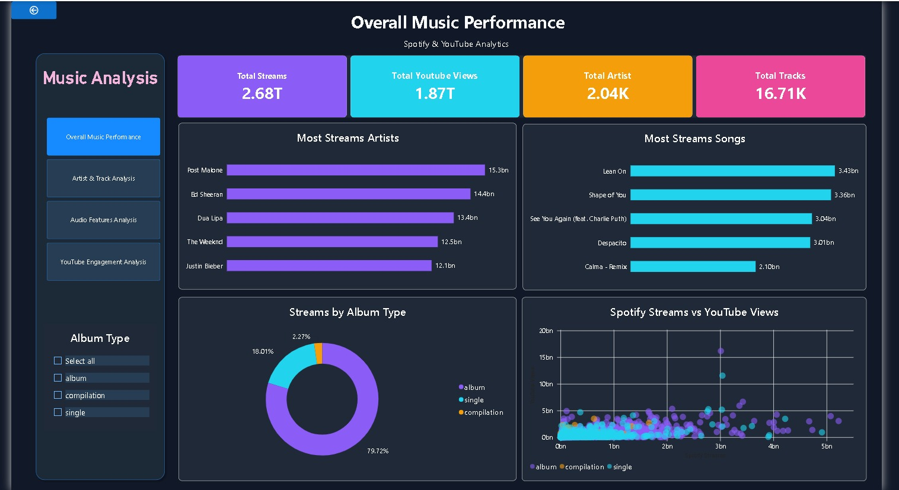
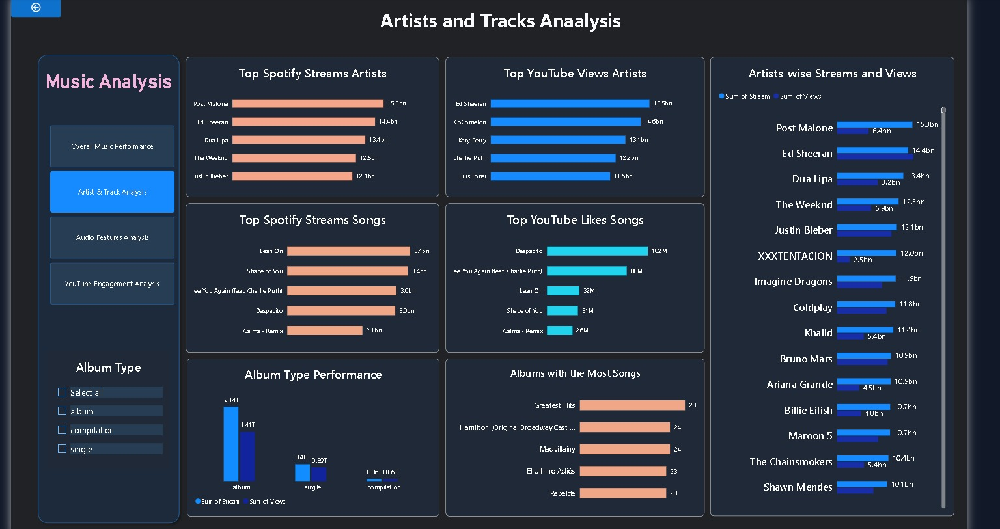
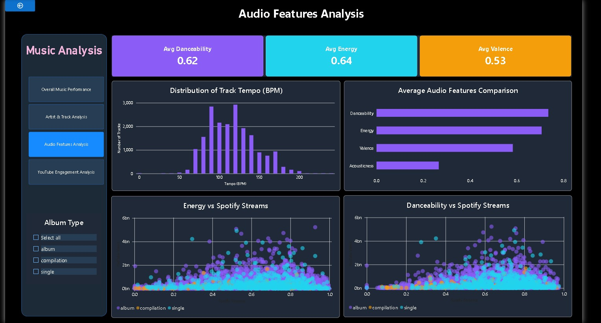
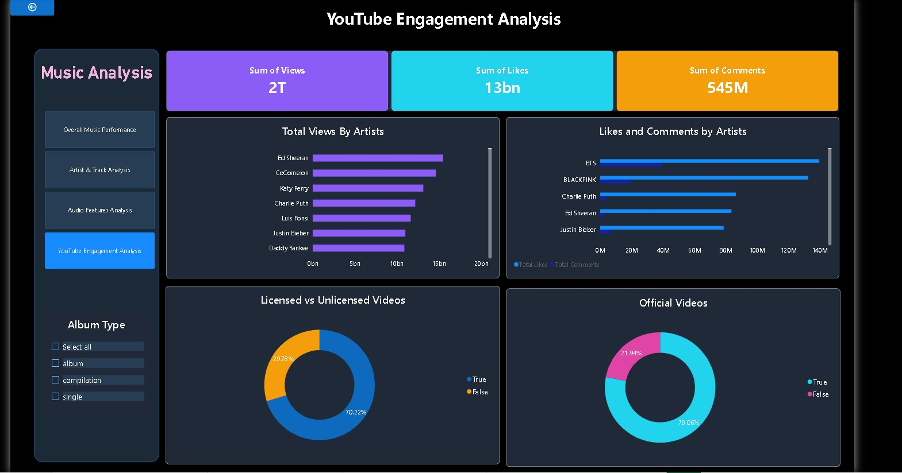

# Spotify & YouTube Music Analytics Dashboard | Power BI

## Project Overview

This project focuses on analyzing music performance across Spotify and YouTube using Microsoft Power BI. It explores streaming activity, video views, audience engagement, artist and track performance, album categories, and audio characteristics.

The objective is to transform raw music data into meaningful insights through interactive dashboards and visualizations.

## Problem Statement

Music tracks can perform differently across digital platforms. A song may receive a high number of Spotify streams while its YouTube video attracts a different number of views, likes, and comments.

The goal of this project is to analyze music performance across both platforms, identify top-performing artists and tracks, compare streaming and viewing activity, and understand audience engagement patterns.

## Project Objectives

- Analyze overall Spotify streams and YouTube views.
- Identify top-performing artists and tracks.
- Compare Spotify streams and YouTube views.
- Analyze YouTube engagement through likes and comments.
- Explore music characteristics such as danceability, energy, valence, and tempo.
- Analyze performance across different album types.
- Create interactive dashboards to support data exploration.

## Dashboard Pages

### 1. Overall Music Performance
- Total Spotify Streams
- Total YouTube Views
- Total Artists
- Total Tracks
- Artist-wise streaming analysis
- Streams by album type
- Track-level comparison of streams and views

### 2. Artist & Track Analysis
- Artist-wise Spotify performance
- Artist-wise YouTube views
- Track-level performance comparison
- Album-type analysis
- Track-wise likes analysis

### 3. Audio Features Analysis
- Average Danceability
- Average Energy
- Average Valence
- Track distribution by Tempo
- Audio feature comparisons
- Relationship between audio features and Spotify streams

### 4. YouTube Engagement Analysis
- Total YouTube Views
- Total Likes
- Total Comments
- Artist-wise views, likes, and comments
- Track distribution by licensed status
- Official video analysis

## Dashboard Screenshots

### Overall Music Performance


### Artist & Track Analysis


### Audio Features Analysis


### YouTube Engagement Analysis


## Tools & Technologies

- **Microsoft Power BI** – Dashboard development and data visualization
- **Power Query** – Data cleaning and transformation
- **DAX** – Measures and calculations
- **Data Analytics** – Data exploration and performance analysis

## Key Metrics

| Category | Metrics |
|---|---|
| Spotify Performance | Streams |
| YouTube Performance | Views |
| Audience Engagement | Likes, Comments |
| Music Information | Artist, Track, Album |
| Album Analysis | Album Type |
| Audio Features | Danceability, Energy, Valence, Tempo |
| Content Attributes | Licensed, Official Video |

## Project Workflow

1. Data Collection
2. Data Understanding
3. Data Cleaning and Transformation
4. Data Modeling
5. DAX Measures and Calculations
6. Data Visualization
7. Dashboard Development
8. Performance Analysis

## Repository Structure

```text
Spotify-YouTube-Music-Analytics/
│
├── README.md
├── Spotify vs Youtube.pbix
├── Spotify_YouTube_Analytics_Problem_Statement.docx
├── Spotify_Youtube_Dataset-compressed.zip
│
└── Screenshot/
    ├── Music_analysis.jpeg
    ├── Artist_analysis.jpeg
    ├── Audio_analysis.jpeg
    └── Youtube_analysis.jpeg
```

## How to Use

1. Clone or download this repository.
2. Extract the compressed dataset if you want to explore the source data.
3. Open `Spotify vs Youtube.pbix` using Microsoft Power BI Desktop.
4. Navigate through the four dashboard pages.
5. Use the available filters and interactive visuals to explore the data.

## Key Learning Outcomes

- Hands-on experience with Power BI.
